## Part 1: Bones pràctiques en la documentació de commits
0. He creat el repositori públic <br> 
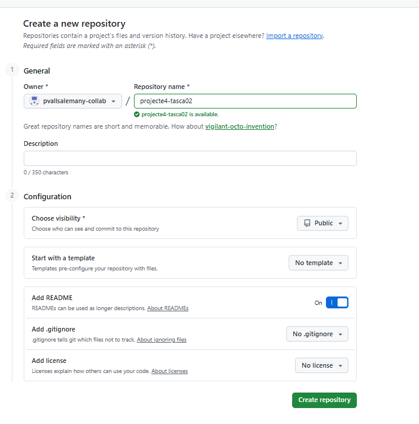 

1. Fes el teu primer commit seguint la convenció de missatges de commit que hem vist abans:
```
docs: inicialitza la repositori de prova per tasca 2
```
He fet el ptimer commit
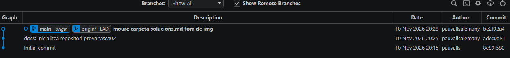 <br>
<br>
<br>


2. He creat un fitxer `00-installer-config.yaml`
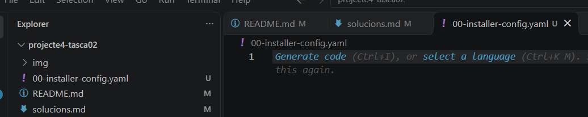

3. He inserit aquest text:
```
network:
  version: 2
  renderer: networkd
  ethernets:
    enps03:
      dhcp4: true
```

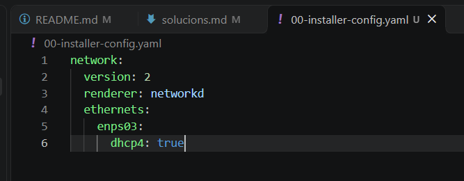
<br>

4. Ho afageixo a **l'àrea dels canvis temporals** executant:
```
git add 00-installer-config.yaml
```
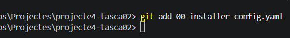

5. Ara faig el commit tipu `feat` executant la sagüent comanda:
```
git commit -m "feat: afegeix configuracio inicial de xarxa"
```
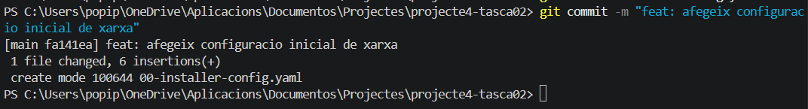

6. Ara després del commit i posar el missatge faig un push executant:
```
git push
```
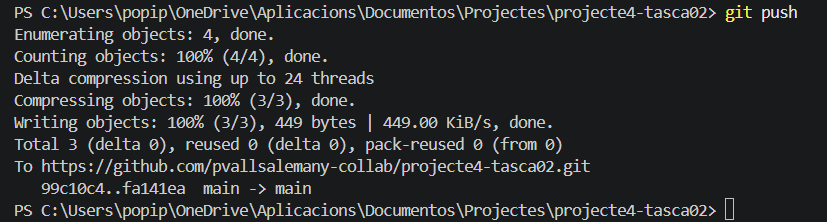


## Part 2 L'historial del repositori

1. He executat la comanda `git log` per visualitzar l'historial detallat del repositori.
```
git log
```
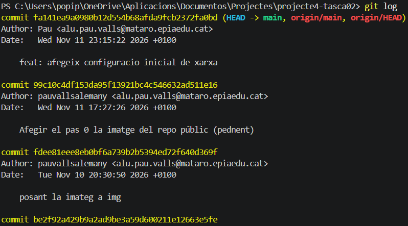 <br>
Aquesta comanda mostra:
- L'identificador (hash) de cada commit.
- L'autor que ha realitzat el canvi.
- La data del commit.
- El missatge descriptiu associat.


2. He executat la comanda git log --oneline per visualitzar una versió resumida de l'historial.
```
git log --oneline
```
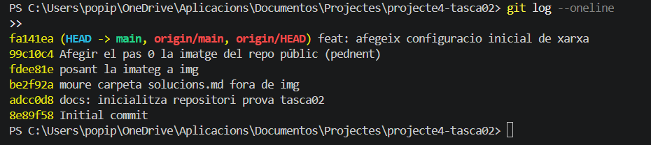
A diferència de `git log`, aquesta mostra cada commit en una sola línia amb:
- El hash abreujat.
- El missatge del commit.

3. He utilitzat Git Graph per visualitzar gràficament l'historial del repositori. Aquesta eina permet veure la seqüència de commits de manera més visual que la terminal. També permet identificar les branques existents i observar l'ordre en què s'han realitzat els commits.


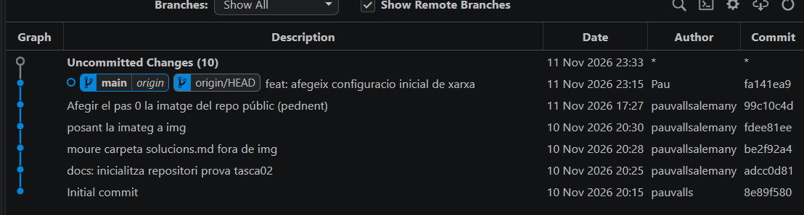


4. He executat la comanda git show HEAD per veure la informació del darrer commit i els canvis realitzats. Per fer-ho he executat:
```
git show HEAD
```
.png)
> HEAD és un punter que apunta al commit més recent de la branca actual.


## Part 3 Recuperar versions anteriors del working directory

1. Simular l'error humà canviant enp0s3 per a eth0 dins del fitxer `00-installer-config`
```
network:
  version: 2
  renderer: networkd
  ethernets:
    eth0:
      dhcp4: true
```
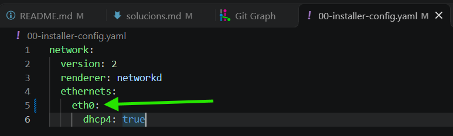

2. Miro l'estat actual dels fitxers executant:
```
git status
```
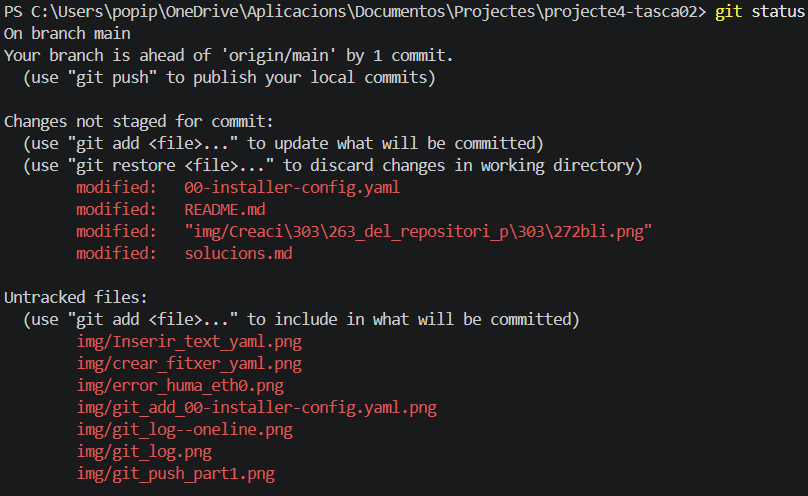

> [!NOTE]
> He modificat el fitxer `00-installer-config.yaml` simulant un error en la configuració.
> Mitjançant la comanda `git status` he comprovat que Git detecta els canvis realitzats respecte a l'últim commit.


3. Ara he de recuperar el fitxer tal com estava a l'últim commit i elimina els canvis que he fet al Working Directory. Amb el restore

```
git restore 00-installer-config.yaml
```


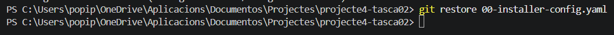

El canvi que he vist
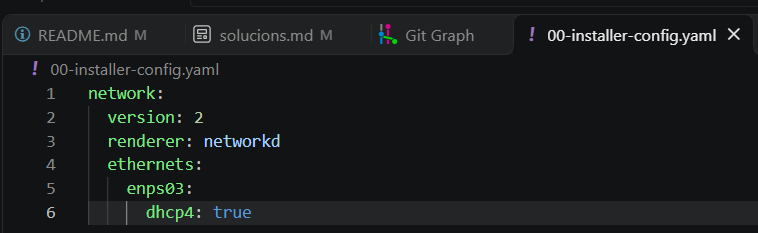

> [!NOTE]
> Després d'executar `git restore 00-installer-config.yaml`, el fitxer ha tornat a l'estat de l'últim commit. Es pot observar que la interfície torna a aparèixer com a `enps03`, recuperant la configuració original. 
4. Veure l'estat executant
```
git status
```
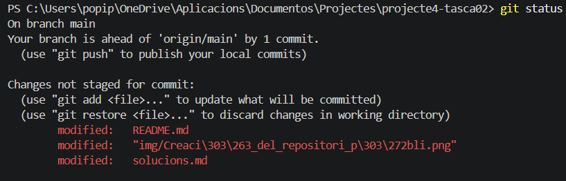


## Part 4: Recuperar versions anteriors (commits) del repositori

1. Configuro el fitxer .yaml la interfície enps03 a una IP estàtica
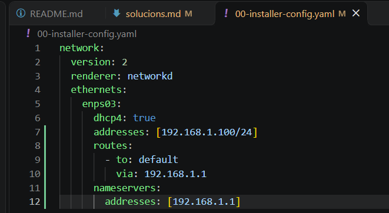

2. Ho afageicxo en el espai temporal de preparació i realitzo el commit

```
git add 00-installer-config.yaml
git commit -m "feat: configura interfície enps03 amb IP estàtica"
```


3. Edito de nou el fitxer `yaml` configurant la interfície **enps08** 

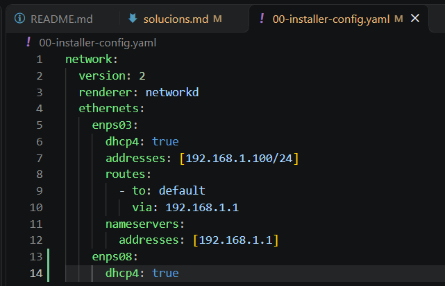

4. Ara torno a realitzar un git add i un commit tipu feat del fitxer .yaml després de configurar la interície enps08
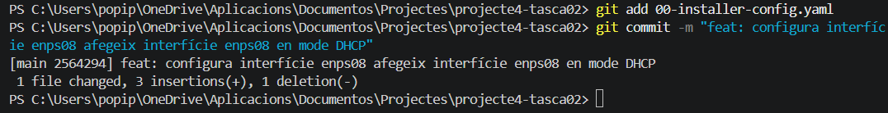


5. Canviar la configuració per **actualitzar el DNS** a la configuració de la interfície `enps03` ja que la configuració inicial no funcionava (aquí el enps08 desapareix)

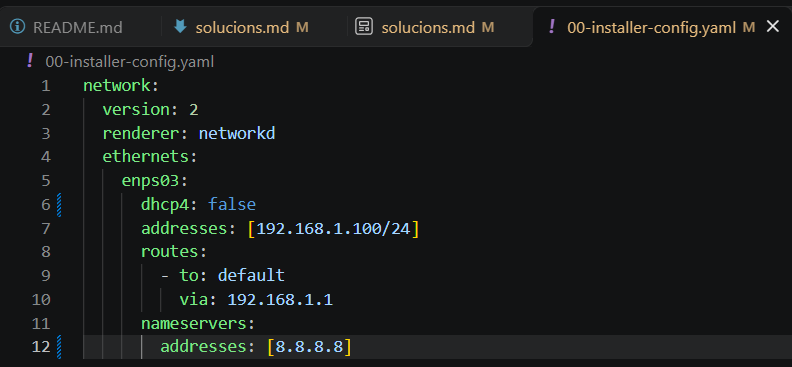

6. Faig el commit desde la terminal tornant a fer aquest procés: git add i després commit amb un missatge descriptiu
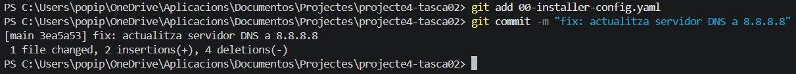


7. Reviso el historial de versions executant
```
git log --oneline
```


8. Faig revert en els 3 últims commits sense editar per fer-ho he d'executar:
```
git revert --no-edit 3ea5a53 2564294 8327b6f
```
Verificació: Git crearà tres nous commits de tipus `Revert "..."` sense demanar-te que editis missatges, i si obres el fitxer `00-installer-config.yaml`, tornarà a tenir només la configuració DHCP inicial per a `enps03`

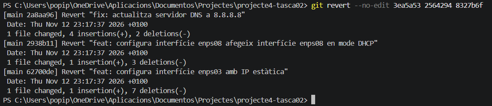

Resultat en el fitxer .yaml després del revert <br>
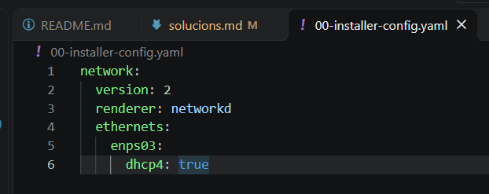

Evidència amb el **Git Graph**
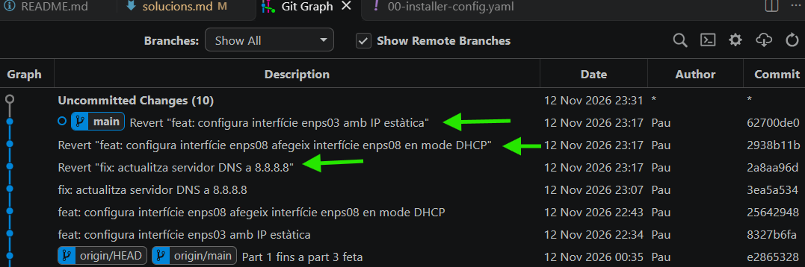


9. Explorar el quart commit anterior usant la eina gràfica documentant-lo

- Dins de `source control` vaig a `View Git Graph(git log)`

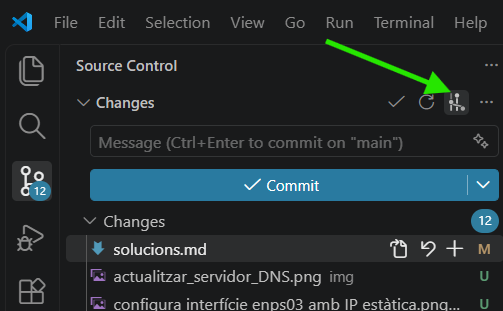

- Ara dins del Git Graph view faig clic a un commit i clico a la part dreta on surt (+2 | -4)
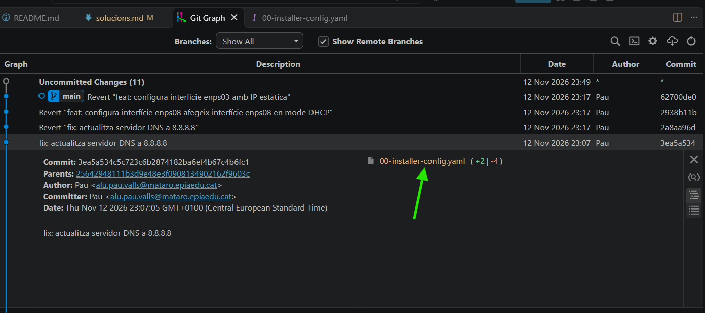

- Felicitats ja pots veure la comparativa actual amb el d'abans

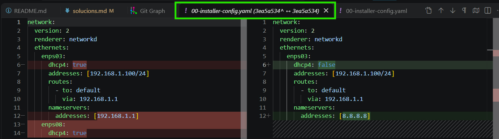

>Vermell: El que es va esborrar |
>Verd: El que s'ha afegit

## Part 5: Git Reset (no és recomenable per el procediment ni en treballs de grup)
**Abans de fer git reset:** La comanda `git reset --hard HEAD~1` elimina de manera permanent l'últim commit i qualsevol canvi no desat al directori de treball.
1. Desa tot el meu progrés fins ara amb un commit de seguretat:
```
git add solucions.md img/
git commit -m "docs: documenta punt 5 exploració de commit"
```
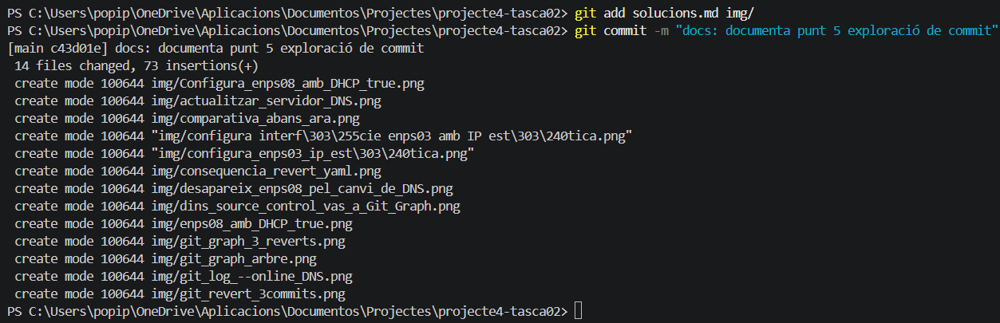

2. Abans de fer el reset també comprovo el historial actual executant:
```
git log --oneline
```
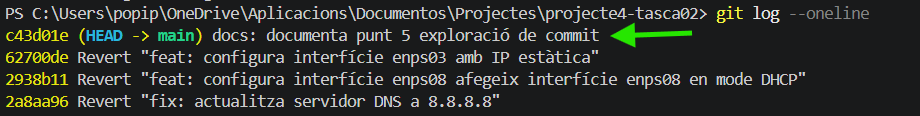

3. Desa els canvis que tinc pendents en solucion..md
```
git add solucions.md
git commit -m "docs: afegeix captura prèvia al reset"
´´´


